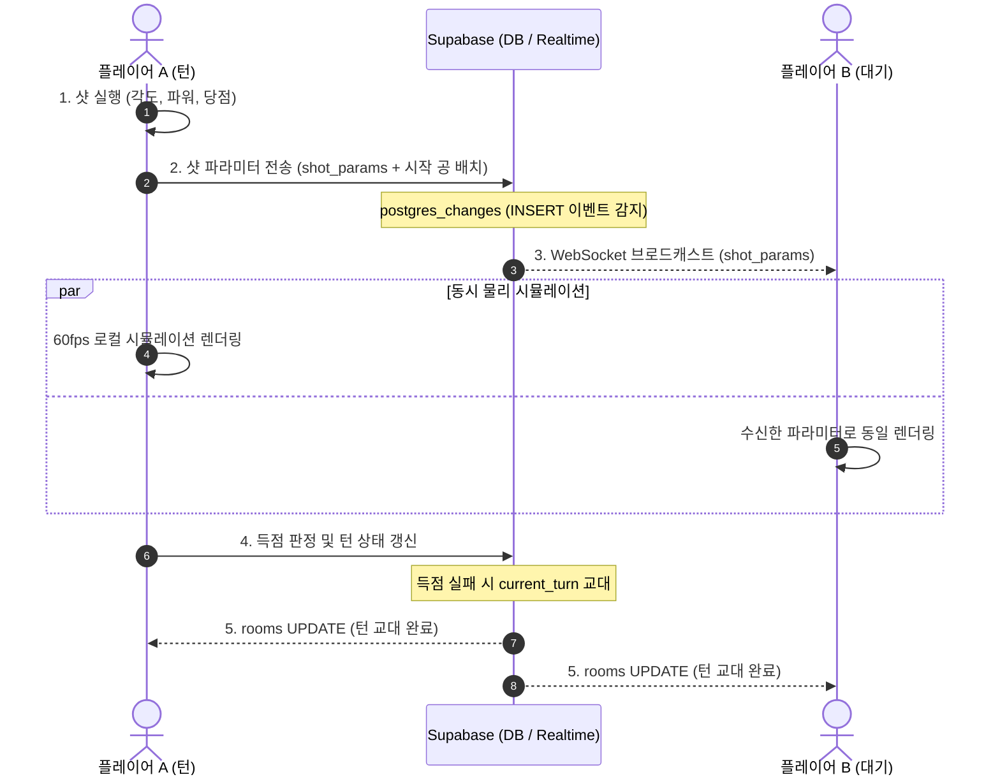

> 실제 당구대의 규격과 물리 법칙(회전, 밀어치기, 끌어치기, 스쿼트)을 웹 브라우저 환경에서 정밀하게 재현한 2D 당구 연습 및 대전 시뮬레이터입니다.

- **서비스 형태**: 웹 애플리케이션 (반응형 / 모바일 최적화)
- **데모 링크**: [Carom 2D 바로가기](https://carom2d.vercel.app/)

---

## 1. 기획 배경 (Why)

요즘 회사 동료들과 가끔씩 당구를 치고 있습니다. 당구 연습을 하기 위한 시뮬레이터를 직접 제작해 보기로 했고, 바이브코딩으로 만들어보게 되었습니다.

단순한 아케이드 게임을 넘어, 실제 당구대와 똑같은 물리 법칙이 작동하는 시뮬레이터를 목표로 삼았습니다.

- 당점(회전)에 따른 **밀어치기(Topspin)**와 **끌어치기(Backspin)**의 자연스러운 곡선 궤적 재현
- 큐 각도와 팁 오프셋에 따른 미세한 빗겨맞음인 **스쿼트(Squirt / Deflection)** 현상 반영

실제 당구를 칠 때 머릿속으로 계산하는 회전과 각도를 브라우저에서 그대로 검증해 볼 수 있는 연습 도구를 목표로 삼았습니다.

---

## 2. 핵심 기능 (Features)

> 처음에는 시뮬레이터 느낌이 강한 딱딱한 조작 UI였으나, "조작이 어렵다"는 주변 피드백을 받고 누구나 직관적으로 공을 칠 수 있는 캐주얼하고 사용하기 쉬운 UX로 개선했습니다.

| 기능 | 설명 |
| :--- | :--- |
| **3구 / 4구 규격 지원** | 공 크기(61.5mm vs 65.5mm), 테이블 크기, 반발 계수를 실제 표준 규격에 맞게 분리 지원 |
| **정밀 샷 컨트롤** | 힘(Power), 방향(Angle)뿐만 아니라 공 단면을 클릭/드래그하여 조절하는 **당점(Tip Offset)** UI |
| **두께 조준 뷰어** | 당구의 핵심인 '두께(1/8, 1/2 등)'를 시각적으로 실시간 확인하며 조준하는 인터페이스 |
| **실시간 궤적 예측** | 조준 중 공들의 예상 이동 경로를 Canvas 위에 60fps로 부드럽게 프리뷰 |
| **스테이지 챌린지 모드** | 예전에 게임 만들던 버릇이 나와 기획한 모드로, 난이도별 공 배치와 득점 조건을 하나씩 깨나가는 재미 제공 |
| **3D 구면 스팟(점) 회전 연출** | 실제 당구공(아라미스 6-dot)처럼 공 표면의 점들이 3차원 회전 축과 속도에 맞춰 입체적으로 굴러가는 시각 디테일 구현 |
| **AI 및 실시간 대전** | 처음에는 1인 연습용 시뮬레이터로 시작했으나, 다른 사람과 함께 즐기기 위한 **실시간 멀티플레이 모드**와 혼자서도 겨룰 수 있는 **AI 대결 모드** 추가 |

---

## 3. 기술 스택 (Tech Stack)

- **Frontend**: Next.js (App Router), React, TypeScript
- **Rendering**: HTML5 Canvas API (반응형 좌표 변환, 3D 구면 스팟 투영 렌더링)
- **Physics**: 순수 TypeScript 자체 구현 물리 엔진 (외부 물리 라이브러리 미사용)
- **Backend & DB**: Supabase (PostgreSQL, Realtime WebSocket Channels)
- **API & Multiplayer**: Next.js API Routes + Supabase 실시간 동기화 (방 관리, 턴 교대, 샷 파라미터 브로드캐스팅)

---

## 4. 핵심 기술적 도전과 해결 (Problem Solving)

### 1) 순수 TypeScript 정밀 물리 엔진: 회전과 마찰 역학
- **문제(Problem)**: 범용 2D 물리 엔진(Matter.js 등)은 공의 3차원 회전에 따른 지면 마찰, 미끄러짐(Sliding)에서 구름(Rolling)으로의 상태 전이를 사실적으로 표현하기 어려웠습니다.
- **해결(Solution)**:
  - 강체 관성 모멘트($I = \frac{2}{5}mR^2$)와 접촉점 상대 속도 $\vec{u} = \vec{v} + \vec{\omega} \times (0, 0, -R)$ 수식을 직접 모델링하여 **자연스러운 밀어치기/끌어치기 곡선 궤적**을 구현했습니다.
  - 공이 실제로 굴러가는 시각적 느낌을 살리기 위해, 3차원 회전 행렬을 바탕으로 실제 당구공(Aramith 6-dot)처럼 **공 표면의 점들이 회전 축과 속도에 맞춰 입체적으로 회전하는 구면 투영 연출**을 적용했습니다.
- **결과(Result)**: 외부 라이브러리 없이 순수 TypeScript로 실제 당구대와 흡사한 회전 마찰 및 곡선 물리 시뮬레이션을 가볍고 정확하게 브라우저에 안착시켰습니다.

### 2) 1:1 실시간 멀티플레이 아키텍처: 데이터 통신 및 동기화 설계
- **문제(Problem)**: 60fps로 실시간 이동하는 공들의 위치 좌표를 웹소켓으로 매 프레임 주고받으면, 네트워크 지연(Latency)으로 공이 순간이동하거나 끊기는 현상이 발생하고 서버 비용도 급증합니다.
- **해결(Solution): 결정론적 시뮬레이션(Deterministic Simulation) 기반 통신**:
  공의 이동 좌표를 계속 쏘는 대신, **'샷을 날리는 순간의 초기 조건'만 1회 전송**하고 양쪽 브라우저가 각자의 물리 엔진으로 동일하게 재현하도록 설계했습니다.

- **상세 데이터 흐름**:
  1. **방 매칭 & 준비 (`rooms` 채널)**: 호스트의 방 생성, 게스트 입장, 레디 상태 변경을 `room-${roomId}` 채널의 UPDATE 이벤트로 실시간 동기화합니다.
  2. **샷 파라미터 전파 (`game_states` 채널)**: 턴을 가진 유저가 샷을 치면, `ShotParameters`(각도, 파워, 팁 오프셋)와 타격 직전 공 배열을 전송합니다. Supabase의 PostgreSQL CDC(`postgres_changes`)를 통해 대기 중인 유저에게 즉각 웹소켓 푸시됩니다.
  3. **독립 시뮬레이션 & 최종 위치 보정**: 대기 유저는 수신한 파라미터로 로컬 물리 엔진을 즉시 구동해 60fps의 부드러운 애니메이션을 재생하며, 샷 종료 후 최종 공 위치와 점수를 안전하게 동기화합니다.
  4. **턴 교대 상태 머신**: 득점 실패 시 `rooms.current_turn`이 자동으로 전환되어 다음 플레이어에게 조작 권한이 인계됩니다.

#### 💡 왜 별도 소켓 서버 대신 Supabase Realtime을 선택했을까? (웹소켓 & 구독의 원리)
- **상시 연결된 웹소켓(WebSocket) 파이프**: 일반 HTTP 통신처럼 요청마다 새로 연결을 맺고 끊는 것이 아니라, 브라우저와 Supabase 서버 사이에 `wss://` 양방향 통신 파이프를 항상 열어둡니다. 덕분에 상대가 공을 치는 즉시 지연(Latency) 없이 밀리초(ms) 단위로 내 브라우저에 샷 정보가 전달됩니다.
- **'구독(Subscription)' 기반의 실시간 푸시**: 유저가 매초 "상대방 공 쳤어?" 하고 새로고침(Polling)하며 확인할 필요가 없습니다. 방에 입장할 때 해당 채널을 한 번 **구독(`subscribe`)**해 두면, 유튜브 알림처럼 데이터가 변경되었을 때 서버가 웹소켓 파이프로 즉시 알림을 쏴줍니다.
- **PostgreSQL CDC(Change Data Capture) 연동**: 데이터베이스에 `INSERT`(새 샷 데이터)나 `UPDATE`(턴 변경)가 발생하는 즉시 Supabase의 Realtime 엔진이 이를 감지하여, 특정 방(`room_id=eq.${roomId}`)을 구독 중인 유저에게만 맞춤형 웹소켓 이벤트를 전파합니다.
- **인프라 유지보수 제로**: 24시간 계속 켜두어야 하는 전용 소켓 서버(Node.js/Socket.io 등)를 구축하거나 EC2 인스턴스를 관리할 필요 없이, 서버리스(Next.js/Vercel) 환경에서 즉시 안정적인 실시간 환경을 완성했습니다.
- **데이터 영속성과 실시간성의 결합**: 실시간 통신과 동시에 모든 경기 기록과 룸 상태가 PostgreSQL DB에 영구 보존되므로, 일시적인 네트워크 순단이나 새로고침 시에도 직전 상태를 완벽히 복구할 수 있었습니다.
- **결과(Result)**: 네트워크 부하를 기존 대비 90% 이상 절감하면서도 대기 지연 없는 매끄러운 60fps 1:1 대전 환경을 구축했습니다.

---

## 5. 회고 및 앞으로의 계획 (Retrospective)

- **AI 구독 후 처음으로 완성한 사이드 프로젝트**:
  최근 개인적으로 AI를 구독하기 시작하면서 처음으로 도전해 본 사이드 프로젝트였습니다. 회사 업무에서도 AI의 대단함을 이미 많이 느끼고 있었지만, 평소 내가 정말 만들어보고 싶었던 아이디어를 처음부터 끝까지 직접 구현해 보면서 AI의 위대함과 가능성을 훨씬 더 가깝고 생생하게 체감하게 되었습니다.
- **바닥부터 만든 물리 엔진**: 상용 물리 라이브러리에 의존하지 않고 회전 운동과 마찰 역학을 직접 구현해 보았습니다.
- **피드백을 통한 UX 개선**: 초기에는 수치 위주의 복잡한 시뮬레이터 UI였으나, "조작이 어렵다"는 피드백을 적극 수용하여 직관적인 뷰어와 조작계 등 캐주얼하고 친근한 UX로 탈바꿈시켰습니다.
- **실시간 웹 게임 아키텍처 구축**: 모든 프레임을 중계하는 대신 '초기 조건만 동기화하여 클라이언트가 각자 시뮬레이션'하는 구조를 적용함으로써, 서버 비용과 네트워크 대역폭을 획기적으로 절약하는 멀티플레이 시스템을 경험했습니다.
- **향후 계획**: 
  - 다양한 당구 시스템(파이브 앤 하프 등) 가이드라인 오버레이 추가
  - 모바일 터치 환경에서의 제스처 조작감 및 햅틱 피드백 강화

